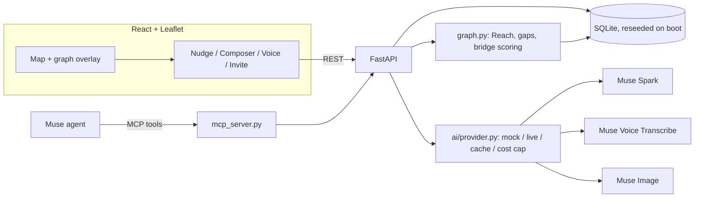

# Porchlight — AI Neighbor Connection Map — Build Guide (HackTX '26, Meta Track)

A live map of the people who live near you, with your **connection graph drawn on top of physical space**: lines to the neighbors you've actually met, thicker the more you've hung out, and visible **gaps** where you haven't reached anyone yet. Open invitations appear as pins ("Board games at #14, 2 seats left"), anyone can voice-post one hands-free, and **Muse** handles the awkward part: it spots the gap, suggests a low-pressure first step, and drafts the first message — which the human edits and sends. One engine runs two settings: a **house neighborhood** (Hyde Park, Austin) and an **apartment complex** (a West Campus building), switched with a toggle. All residents are fictional.

> **Thesis (say this in the first 10 seconds of every pitch):** *Porchlight shows you the neighbors you've reached and the ones you haven't, then lets Muse make the next hello easy.*

## Tech stack

`Python 3.11 + FastAPI` · `SQLite (reseeded on boot)` · `networkx` · `sentence-transformers (all-MiniLM-L6-v2)` · `Meta Model API — Muse Spark` · `Muse Voice Transcribe` · `Muse Image` · `MCP (Python mcp SDK) for the Muse connector` · `React + Vite + TypeScript` · `react-leaflet + OpenStreetMap tiles` · `Gemini / Canva (UI design pass)` · `Docker` · `Vercel (frontend)` · `Google Cloud Run or Render (backend)` · `GitHub Actions (CI, light)`

> Note: your usual stack is Next.js + Groq. Two deliberate changes here. **Groq is out** — the Meta track rewards Meta's models, so every AI call goes through the Meta Model API (Groq is allowed only as an emergency fallback behind the same interface, and should not be on in the demo). **Vite instead of Next.js** — there's no SEO or server-rendering need, and Vite removes a class of SSR/Leaflet `window is undefined` errors that cost real time at a hackathon.

## Meta Model API — what's verified (and what isn't)

From Meta's developer blog and docs as of Oct 2026 (re-check on `dev.meta.ai` before relying on any of it):

| Thing | Value | Confidence |
|---|---|---|
| Where to get a key | `dev.meta.ai` → API keys tab | Verified (Meta blog) |
| Base URL | `https://api.meta.ai/v1` | Verified (Meta blog) |
| SDK | **OpenAI-compatible** — point the OpenAI Python SDK at the base URL | Verified (Meta blog) |
| Text model | `muse-spark-1.1` / `1.2` listed on Meta's site; `muse-spark-1.3` reported as latest (Sept 2026) | Check the Models page; keep it in an env var |
| Endpoints | Responses API (Meta's recommended surface), Chat Completions, and Anthropic-style Messages | Verified via third-party provider docs |
| Image model | `muse-image-1.0`, `POST /v1/images/generations` and `/v1/images/edits`, **$0.01/image** | Verified (Meta blog) |
| Voice | Speech-to-text docs at `dev.meta.ai/docs/speech-to-text`; realtime over `wss://api.meta.ai/v1/asr/realtime` | Endpoint from LiteLLM docs — **read Meta's page for the audio format and whether a file-upload endpoint exists** |
| Spark pricing | ~$1.25 / 1M input tokens, ~$4.25 / 1M output tokens | Third-party source — verify on Meta's pricing page |
| Muse (agent) connectors | Muse app launched Sept 8, 2026; developer connectors opened later that month; Muse can build a custom integration when handed an MCP server URL / OpenAPI doc; Muse Code supports MCP servers via `~/.config/muse/settings.json` | Third-party reporting — **confirm the hackathon-friendly path at the Meta workshop** |
| Facebook Graph API | App dashboard at developers.facebook.com | Skip unless trivial (see P2) |

## Cost plan ($50 Meta credit, everything else $0)

**Meta Model API:** the $50 credit. At the prices above, a typical nudge call (~2k input tokens, ~400 output tokens) costs roughly **$0.004**, so Spark is not the budget risk — **reasoning tokens, accidental loops, and voice** are. Muse Image at $0.01/image is cheap but pointless to regenerate during testing.

Budget rules (enforced in code, Phase 5):
- **Hard cap $40** in the cost meter; the remaining **$10 is reserved for judging day**. When the cap is hit, the backend refuses live calls and serves cached/mock responses.
- **`AI_MODE=mock` is the default for development.** Live mode only when testing a Meta integration on purpose.
- **Cache every live response** by a hash of (model, prompt). Re-running the demo costs $0.
- Don't use the credit to vibe-code (e.g., Muse Code) — keep it for the product.

**Everything else:** OpenStreetMap tiles (free, low-volume demo use), Vercel free tier, Cloud Run (free tier / your GCP credit) or Render free tier, GitHub Actions free tier. **Optional:** a `.tech` domain via the MLH prize track (free for winners, cheap otherwise).

## Product context

**The problem**

1. **Proximity without connection** — people live meters apart for years without knowing each other's names; existing apps (Nextdoor, Meetup, Partiful) are bulletin boards or event tools, not relationship builders.
2. **The first hello is awkward** — the barrier isn't interest, it's the cold open: who, when, and what do I even say?
3. **You can't see your own social map** — nobody knows which parts of their neighborhood or building they've never reached.

**The core loop (this is the demo)**

1. The map shows your connection graph — thick lines to neighbors you see often, and a visible **gap** in one cluster (a street or a building wing).
2. Muse spots the gap and suggests a **low-pressure first step** ("Priya on Duval walks her dog around 6 — want to say hi?").
3. You accept by voice or tap; Spark drafts the first message; **you edit and send it**.
4. The meetup happens; you mark it; the line appears and thickens.
5. **Reach** updates — the before/after number.

**One engine, two communities (combined framing)**

| | Community A — Neighborhood | Community B — Apartment complex |
|---|---|---|
| Setting | Hyde Park, Austin (real streets, fictional people) | "The Quarry Lofts" — a fictional West Campus complex |
| Cluster unit | Street (e.g., Avenue G, Duval St) | Building wing / floor |
| Pin flavor | Porch board games, dog walks, block party | Study break in the courtyard, rooftop sunset, laundry-room swap |
| Size | ~40 residents, 5 clusters | ~30 residents, 3–4 clusters |

The only difference between the two is the **seed file**. Same schema, same engine, same UI, one toggle. **Scope guard: if B starts costing time, cut B and keep A.**

**The metric — Reach**

- `reach(cluster) = members you've met in the cluster / (members in the cluster − you)`
- Overall reach = met / everyone in the community.
- `edge_strength(a, b) = Σ exp(−days_since_hangout / 30)` over their hangouts → mapped to line width.
- The demo shows a before/after: "Duval St reach 0% → 17%, overall 6 → 7 neighbors met."

## 📋 Feedback register (decisions carried from the planning session)

Every item here was decided on purpose. If a vibe-coding session drifts from one of these, it's a bug.

| # | Decision | Where it's implemented |
|---|---|---|
| 1 | **Depth over breadth.** Spark and Voice are the core; Image is minimal. Two essential integrations beat four shallow ones. | Phases 5, 6, 13 |
| 2 | **Muse calls our app** (connector exposing our actions as tools), not "our app has an agent." Fallback: the same tools via Spark function calling in our UI. | Phase 10 |
| 3 | **Seeded fake communities** so the map is never empty in the demo. | Phase 2 |
| 4 | **Privacy & safety by design:** block-level fuzzed locations, address revealed only after host approval, verified-neighbor concept, no real personal data. | Phases 2, 11 |
| 5 | **Queue / waitlist is plumbing, not the headline.** Build it simply; never pitch it first. | Phase 11 |
| 6 | **The connection graph + AI nudges is the differentiator.** Every screen should point at it. | Phases 4, 8 |
| 7 | **A measurable "closer together" metric** (Reach) with a before/after in the demo. | Phases 4, 9 |
| 8 | **The AI drafts, the human sends.** No auto-sending, ever. | Phases 5, 8 |
| 9 | **Low-pressure first-step mode** — a wave or a hello, not a dinner party. | Phases 5, 11 |
| 10 | **Cost cap in code**, response caching, pre-generated Image asset. | Phases 5, 13 |
| 11 | **Workshop check** — confirm connector path, Spark model ID, voice format at the Meta workshop (Sat 3:00pm, GDC 2.216) or `#ask-meta` on Discord. | Phase 0 |
| 12 | **Cut/fake list:** Image recap, reminders, weather rescheduling are pre-generated or roadmap. | Scope tiers |
| 13 | **Combined framing:** neighborhood + apartment complex from one schema and a toggle; cut B first if needed. | Phases 2, 8 |
| 14 | **Groq out, Meta in** for every AI feature in the demo. | Phase 5 |
| 15 | **Honest eval** on synthetic data, with its limitations written down (your GhostKube/squash habit). | Phase 12 |

## 🎯 Scope tiers

**P0 — must work in the demo** (nothing from P1 starts until every P0 box is ticked)

- [ ] Map with live pins (invitations + "free to hang out" statuses) on seeded data
- [ ] Connection graph overlay — line width = edge strength
- [ ] Gap detection per cluster + Reach metric (cluster chips + overall)
- [ ] Spark: gap-aware nudge + drafted first message (editable, human sends)
- [ ] Voice Transcribe: voice-post an invite → structured pin
- [ ] Community toggle A/B (only because the schema is generic — cut B if it fights you)
- [ ] "Mark as met" → line appears/thickens → Reach updates live
- [ ] Deployed link that works on a phone + "Reset demo" button

**P1 — if time allows**

- [ ] Muse connector (MCP server exposing `post_invite`, `join_event`, `get_nearby_gaps`) — or the Spark function-calling fallback
- [ ] Join + waitlist flow ("2 seats left" → full → waitlist → auto-promote on cancel)
- [ ] Low-pressure first-step mode (toggle: "small ask" vs "invite")
- [ ] Bridge-scoring eval script with top-3 hit rate vs baselines
- [ ] Safety layer: fuzzed pins, host approval before address reveal, "verified neighbor" badge

**P2 — pre-generate, fake, or roadmap**

- [ ] Muse Image: one pre-generated flyer + one "memory map" recap, cached as static files
- [ ] Reminders, weather/conflict rescheduling (roadmap slide only)
- [ ] Facebook Graph API sign-in / interests import
- [ ] Real multi-user auth, push notifications
- [ ] Learned weights for bridge scoring (instead of hand-set)

## ✅ Success metrics (what you show at the end)

| Metric | Target |
|---|---|
| Core loop end-to-end on the deployed link | Works 3 times in a row on a phone |
| Demo Reach before/after | Visible change (e.g., 0% → 17% on the gap cluster) |
| Live Meta calls in the demo | Spark (nudge + message), Voice (transcribe), + connector if P1 lands |
| Nudge latency | < 4 s perceived (show a skeleton state; cache the demo path) |
| Bridge-scoring eval | Top-3 hit rate reported against random + proximity-only baselines, with caveats |
| Spend | Under $40 at submission, $10 reserved |

## Timeline overview (gates, not hours — you're vibe coding)

| Phase | Focus | Gate |
|---|---|---|
| 0 | Meta access, keys, workshop questions | **G1: a live Spark call returns text** |
| 1 | Repo + vibe-coding context file | |
| 2 | Data model + seed data (A and B) | |
| 3 | Backend API (FastAPI) | |
| 4 | Graph engine — Reach, gaps, bridge scoring | |
| 5 | Muse Spark — nudges, messages, cost meter, mock mode | |
| 6 | Muse Voice Transcribe — voice-to-pin | |
| 7 | UI design pass (Gemini / Canva prompts) | |
| 8 | Frontend — map, graph overlay, sheets | |
| 9 | Wire the core loop end-to-end + deploy | **G2: core loop live on the deployed link** |
| 10 | P1 — Muse connector (MCP) or function-calling fallback | |
| 11 | P1 — join/waitlist, safety layer, low-pressure mode | |
| 12 | P1 — eval | |
| 13 | P2 — Muse Image (pre-generated) | |
| 14 | Feature freeze, testing, hardening | **G3: feature freeze — Sunday morning, well before 11:30am** |
| 15 | README, Devpost, demo GIF | **G4: final submit by Sun 11:30am** |
| 16 | Pitch + judging prep | Judging Sun 2–5pm (WEL), Pitching 5:30pm (GDC 2.216) |

**Event anchors (from the opening ceremony deck):** Meta workshop Sat 3:00pm GDC 2.216 · building (WEL) unavailable 11pm–6:30am · hacking ends / final submission Sun 11:30am · "How to Pitch" workshop Sun 1:00pm GDC 5.302 · judging Sun 2–5pm · pitching Sun 5:30pm · Devpost: `hacktx26.devpost.com`. **All code must be written during the hacking period** — reuse your habits and patterns, not code from your old repos.

---

## 📚 Phase 0: Meta access, keys & workshop questions

*Goal: a real Spark call working from your laptop before any product code exists. Everything else in this guide can run in mock mode, but this can't.*

**Get access**

- [ ] Create an account at `dev.meta.ai` and generate an API key (API keys tab on the Model API dashboard)
- [ ] Find out how the **$50 hackathon credit** is applied to that account — ask at the Meta table (WEL Hallway expo) or in `#ask-meta` on the event Discord (the deck says each sponsor has an `#ask-xxx` channel)
- [ ] Open the **Models** page and note the exact Spark model ID available to you (`muse-spark-1.3` / `1.2` / `1.1`)
- [ ] Open the **speech-to-text** page (`dev.meta.ai/docs/speech-to-text`) and write down: file-upload endpoint or realtime-only? accepted audio formats / sample rate? language param?
- [ ] Open the **pricing** page; put the real per-token and per-minute prices into `.env` (Phase 5 reads them)

**Smoke test (G1)**

```bash
pip install openai python-dotenv
```

```python
# scripts/smoke_spark.py
import os
from dotenv import load_dotenv
from openai import OpenAI

load_dotenv()
client = OpenAI(
    api_key=os.environ["META_MODEL_API_KEY"],
    base_url=os.getenv("META_API_BASE", "https://api.meta.ai/v1"),
)
resp = client.chat.completions.create(
    model=os.getenv("MUSE_SPARK_MODEL", "muse-spark-1.3"),
    messages=[{"role": "user", "content": "Reply with exactly five words."}],
)
print(resp.choices[0].message.content)
print(resp.usage)  # confirm usage comes back — the cost meter depends on it
```

- [ ] Prints text **and** a `usage` object → **G1 passed**
- [ ] If the model ID 404s, list models (`client.models.list()`) and use what's there
- [ ] Chat Completions is used here because every vibe-coding tool knows it cold; Meta recommends the Responses API as its full-feature surface — switch only if you need a feature Chat Completions lacks

**Questions to bring to the Meta workshop (Sat 3:00pm, GDC 2.216)** — write the answers into `CONTEXT.md`

1. What's the recommended way for a hackathon project to become something **Muse can call**? (Custom integration from an MCP URL in the Muse app? Muse Code `settings.json`? The connector submission form?) Does the judge need their own Muse account to see it?
2. Voice Transcribe: is there a non-realtime (file upload) endpoint, and what audio format does it want?
3. Which Spark model ID should we use, and do reasoning settings affect cost much?
4. Rate limits on the hackathon credit?
5. Does judging favor depth with 2–3 tools or touching all of them? (Our plan: depth.)
6. Is the Facebook Graph API worth touching in 24 hours, or skip?

**Done when:** G1 passed, the six answers are in `CONTEXT.md`.

## 🎯 Phase 1: Repo + vibe-coding context file

*Goal: a monorepo the coding agent can't get lost in. The context file is the single most important artifact for vibe coding — it keeps every session on-thesis and inside scope.*

- [ ] New public repo `porchlight`, MIT license
- [ ] Layout:

```
porchlight/
├── CONTEXT.md            # the brief every AI session reads first
├── backend/
│   ├── app/              # FastAPI app
│   │   ├── main.py
│   │   ├── db.py         # SQLite + reseed on boot
│   │   ├── models.py     # pydantic schemas
│   │   ├── graph.py      # Reach, gaps, bridge scoring
│   │   ├── ai/
│   │   │   ├── provider.py   # live/mock/cache + cost meter
│   │   │   ├── spark.py      # nudges, messages, intent parsing
│   │   │   ├── voice.py      # transcription
│   │   │   └── image.py      # P2
│   │   ├── mcp_server.py # P1 connector
│   │   └── routes/
│   ├── seed/
│   │   ├── generate_seed.py
│   │   ├── community_a_hydepark.json
│   │   └── community_b_quarry.json
│   ├── eval/run_eval.py  # P1
│   ├── tests/
│   ├── requirements.txt
│   └── Dockerfile
├── frontend/             # Vite + React + TS
├── design/               # mockups from Phase 7
└── docs/                 # demo.gif, architecture, limitations
```

- [ ] `.env.example` (never commit `.env`):

```
META_MODEL_API_KEY=
META_API_BASE=https://api.meta.ai/v1
MUSE_SPARK_MODEL=muse-spark-1.3
MUSE_IMAGE_MODEL=muse-image-1.0
AI_MODE=mock                # mock | live
COST_CAP_USD=40
PRICE_IN_PER_M=1.25         # verify on Meta pricing page
PRICE_OUT_PER_M=4.25
PRICE_VOICE_PER_MIN=        # fill from pricing page
MCP_SHARED_SECRET=change-me
FRONTEND_ORIGIN=http://localhost:5173
```

- [ ] `.gitignore`: `.env`, `__pycache__/`, `*.pyc`, `venv/`, `node_modules/`, `*.db`, `cache/`
- [ ] Write `CONTEXT.md` — paste this and keep it updated:

```markdown
# Porchlight — context for AI coding sessions (read first)

Thesis: show people the neighbors they've reached and the ones they haven't,
then let Muse make the next hello easy.

Hard rules:
- Only build what's in the current scope tier. P0 before P1 before P2.
- All AI calls go through backend/app/ai/provider.py (mock/live/cache/cost meter).
  Never call the Meta API from anywhere else. Never from the frontend.
- The AI drafts messages; the human always sends. Never auto-send.
- Locations are fuzzed to block level. Exact addresses only after host approval.
- One schema for both communities. Differences live in seed files only.
- Prefer boring, working code over clever code. No new dependencies without a reason.

Data contracts: (paste the pydantic models from Phase 2 here once written)
API routes: (paste the route table from Phase 3 here once written)
Meta API facts: (paste the verified table + workshop answers here)
```

- [ ] Vibe-coding habit: start every new agent session with "Read CONTEXT.md, then …". When a session drifts, point it at the hard rules.

**Done when:** repo pushed, `CONTEXT.md` committed, `.env` local only.

## 🏘️ Phase 2: Data model + seed data (both communities)

*Goal: two believable fictional communities with a story baked in — specifically, a gap the demo can close. The seed is the demo; spend real care here.*

**Schema (SQLite)**

| Table | Key columns |
|---|---|
| `communities` | `id`, `name`, `kind` (`neighborhood` / `apartments`), `center_lat`, `center_lng`, `zoom` |
| `clusters` | `id`, `community_id`, `name` (Avenue G / East Wing), `polygon` (GeoJSON, for shading) |
| `members` | `id`, `community_id`, `cluster_id`, `display_name`, `emoji_avatar`, `lat`, `lng` (**fuzzed**), `unit_label` (hidden until approved), `interests` (JSON list), `availability` (JSON list of slots like `"wed-evening"`), `verified` (bool), `is_demo_user` |
| `hangouts` | `id`, `a_id`, `b_id`, `date`, `kind` |
| `invites` | `id`, `community_id`, `host_id`, `title`, `activity`, `starts_at`, `capacity`, `lat`, `lng` (fuzzed), `exact_location` (hidden), `requires_approval`, `status`, `source` (`manual` / `voice` / `muse`) |
| `rsvps` | `id`, `invite_id`, `member_id`, `status` (`going` / `waitlist` / `pending_approval` / `cancelled`), `position` |
| `statuses` | `id`, `member_id`, `text` ("free for a walk"), `until` |
| `drafts` | `id`, `from_id`, `to_id`, `nudge_json`, `draft_text`, `final_text`, `sent_at` |
| `api_usage` | `id`, `ts`, `feature`, `model`, `in_tokens`, `out_tokens`, `seconds_audio`, `usd`, `cached` |

**Fuzzing rule:** store real-looking coordinates, but every API response returns `lat/lng` snapped to a ~100 m grid plus a small deterministic jitter (seeded by member id). Units/house numbers never leave the backend unless an RSVP is approved.

**Seed generator** (`seed/generate_seed.py`) — deterministic (`random.seed(42)`), outputs the two JSON files.

Community A — Hyde Park (center ≈ 30.305, −97.728, zoom 16):
- [ ] 5 clusters along real streets: **Avenue G, Avenue F, Speedway, 43rd St, Duval St**
- [ ] ~40 members with plausible interests (dogs, board games, gardening, running, cooking, live music, chess, kids, bikes, coffee) and availability slots
- [ ] Demo user "You" lives on **Avenue G**
- [ ] Hangout history (last 60 days) generated from a **latent compatibility score** (shared interests + schedule overlap + proximity) so the graph looks organic — and so Phase 12's eval has a signal to recover
- [ ] **The story:** You know ~6 people (Avenue G, Avenue F, a couple on Speedway) and **nobody on Duval St** — that's the gap. On Duval, plant **Priya** (dog walker, free weekday evenings, likes coffee — high compatibility with You), so the nudge has a perfect target
- [ ] 6–8 open invites already on the map (board games at a porch, Saturday block party, dog walk, garden swap), one of them on Duval
- [ ] 3–4 "free to hang out" statuses

Community B — The Quarry Lofts (center ≈ 30.287, −97.745, zoom 18):
- [ ] 3–4 clusters: **North Wing, South Wing, Floor 5, Rooftop crew** — drawn as small polygons on the building footprint
- [ ] ~30 members (students + young professionals), interests skew study groups, climbing, gaming, cooking, film
- [ ] Same story shape: You know the North Wing, **nobody in the South Wing**
- [ ] Invites: courtyard study break, rooftop sunset, laundry-room book swap, Floor 5 movie night

**Vibe prompt**

```
Read CONTEXT.md. Create backend/app/db.py and backend/seed/generate_seed.py.
SQLite schema exactly as in the table I paste below. The seed generator is
deterministic (random.seed(42)) and writes two JSON files: community A (Hyde Park,
5 street clusters, ~40 members) and community B (a fictional apartment complex,
3-4 wing clusters, ~30 members). Hangouts are sampled from a latent compatibility
score = interest overlap + availability overlap + proximity, over the last 60 days.
Plant the story: the demo user knows ~6 people and nobody in one cluster
(Duval St in A, South Wing in B), and that cluster contains one high-compatibility
member (Priya in A). On app startup, drop and reseed the DB from the JSON files.
Expose a function reset_demo() that reseeds. All names fictional.
[paste schema table]
```

- [ ] Sanity check: print per-cluster Reach for You in both communities — the gap cluster must be 0%

**Done when:** both JSON files exist, the DB reseeds on boot, and the gap is visible in the numbers.

## ⚡ Phase 3: Backend API (FastAPI)

*Goal: every screen's data available over HTTP, working in mock mode with no keys.*

```
fastapi==0.115.*
uvicorn[standard]
pydantic>=2
networkx
sentence-transformers
numpy
openai
python-dotenv
httpx
pytest
mcp            # P1, Phase 10
```

**Routes**

| Method | Route | Purpose |
|---|---|---|
| GET | `/api/health` | Liveness + `ai_mode` + spend so far |
| GET | `/api/communities` | List A and B |
| GET | `/api/communities/{id}/map` | Members (fuzzed), clusters, invites, statuses, edges with strength |
| GET | `/api/communities/{id}/reach` | Overall + per-cluster Reach for the demo user |
| GET | `/api/communities/{id}/gaps` | Ranked gap clusters |
| GET | `/api/communities/{id}/nudge` | Top bridge candidate + Spark nudge (`?mode=small_ask|invite`) |
| POST | `/api/drafts` | Draft a first message to a member (Spark) |
| POST | `/api/drafts/{id}/send` | Save the human-edited final text; marks as sent (no real delivery) |
| POST | `/api/hangouts` | "Mark as met" → returns updated edge + Reach delta |
| POST | `/api/voice/invite` | Audio upload → transcript → parsed invite → pin |
| POST | `/api/invites` | Create invite (manual) |
| POST | `/api/invites/{id}/join` | Join or waitlist (P1) |
| POST | `/api/invites/{id}/cancel` | Leave; auto-promote waitlist (P1) |
| POST | `/api/rsvps/{id}/approve` | Host approval → reveals exact location (P1) |
| POST | `/api/demo/reset` | Reseed everything |
| GET | `/api/usage` | Spend by feature (for the judges' "what does this cost" question) |

- [ ] CORS limited to `FRONTEND_ORIGIN`
- [ ] Every response that includes members passes through one `public_member()` serializer that applies fuzzing and strips `unit_label` — one choke point, so privacy can't be forgotten in a new route
- [ ] Write `API_SCHEMA.md` (your GhostKube habit) and paste the route table into `CONTEXT.md`

**Done when:** `uvicorn app.main:app --reload` serves every P0 route in mock mode; `/docs` shows them all.

## 🧠 Phase 4: Graph engine — Reach, gaps, bridge scoring

*Goal: the ML/engineering depth that isn't a prompt. This is what makes "the graph is the differentiator" true rather than decorative.*

`backend/app/graph.py` — pure functions over a `networkx.Graph` built from members + hangouts. No API calls in this file.

**Edge strength**

```python
import math
from datetime import date

def edge_strength(hangout_dates: list[date], today: date, half_life_days: float = 30) -> float:
    return sum(math.exp(-(today - d).days / half_life_days) for d in hangout_dates)
```

Map strength to line width on the frontend: `width = 1.5 + 5 * min(strength, 3) / 3`.

**Reach** — as defined in Product context. Return both the ratio and the counts ("1 of 6").

**Gap detection**

```
gap_score(cluster) = size(cluster) * (1 - reach(cluster)) * proximity_weight(cluster)
proximity_weight   = 1 / (1 + distance_km(you, cluster_centroid))
```

Return clusters with `reach < 0.25` and `size >= 3`, ranked by `gap_score`. Clusters come from the seed (streets / wings) — say so honestly; a learned community-detection pass is a P2 idea, not a claim.

**Bridge scoring** — who should you meet next?

```
score(c) = 0.40 * interest_sim(you, c)        # cosine of MiniLM embeddings of interest lists
         + 0.25 * schedule_overlap(you, c)    # Jaccard of availability slots
         + 0.20 * gap_bonus(c)                # 1 if c is in a top-ranked gap cluster
         + 0.15 * warm_path(you, c)           # 1 if you share a mutual connection (friend-of-friend)
excluding people you've already met
```

- [ ] Embeddings: `sentence-transformers/all-MiniLM-L6-v2`, computed once at boot for every member's `", ".join(interests)` and cached in memory (70 members — instant)
- [ ] Return the top 3 candidates **with the component scores**, so Spark can explain *why* in plain words and the UI can show "shared: dogs, coffee · both free Wed evenings · you both know Marcus"
- [ ] Weights are hand-set; say so in the README. Learned weights are P2.

**Tests** (`tests/test_graph.py`) — the one place tests clearly pay off:
- [ ] Reach is 0 for the planted gap cluster, correct for a hand-computed cluster
- [ ] Marking a hangout increases the edge strength and the cluster's Reach
- [ ] Priya is the top bridge candidate in Community A
- [ ] Already-met members never appear as candidates

**Vibe prompt**

```
Read CONTEXT.md. Implement backend/app/graph.py as pure functions: build_graph,
edge_strength (exponential decay, 30-day half-life as written), reach (overall and
per-cluster, return ratio + counts), find_gaps (formula below), bridge_candidates
(weighted formula below, return top 3 with component scores). Use
sentence-transformers all-MiniLM-L6-v2 for interest embeddings, computed once at
startup. No network calls in this module. Then write pytest tests for the four
cases listed. [paste formulas]
```

**Done when:** tests pass; `/gaps` and `/nudge` (mock) return Duval St and Priya for Community A, South Wing for B.

## 🤖 Phase 5: Muse Spark — nudges, messages, cost meter, mock mode

*Goal: the AI layer, built behind one provider so mock/live/cache/cost are impossible to bypass.*

**`ai/provider.py` — the only file that talks to Meta**

Responsibilities:
- [ ] `AI_MODE=mock` → return canned fixtures from `ai/fixtures/*.json` (write realistic ones — the frontend team builds against these)
- [ ] `AI_MODE=live` → call Meta via the OpenAI SDK (`base_url=META_API_BASE`)
- [ ] **Cache**: key = sha256(model + messages + params); store responses on disk (`cache/`). A cache hit is logged with `usd=0, cached=true`
- [ ] **Cost meter**: after each live call, compute `usd` from `usage` and the prices in `.env`, insert into `api_usage`; before each live call, if total ≥ `COST_CAP_USD`, fall back to cache/mock and log a warning
- [ ] **Timeouts + fallback**: 15 s timeout; on error, return the cached/mock response with a `degraded: true` flag so the demo never shows a stack trace
- [ ] Never let a request loop retry more than once

**`ai/spark.py` — three functions**

1. `make_nudge(you, candidate, components, gap_cluster, mode)` → JSON:

```json
{
  "headline": "You haven't met anyone on Duval St yet",
  "why": "Priya also loves dogs and coffee, and you're both free on weekday evenings.",
  "first_step": "She walks her dog past the corner of Duval & 43rd around 6. A wave and a hello is enough.",
  "cta": "Say hi",
  "draft_message": "Hi Priya! I'm on Avenue G and walk my dog around 6 too. Want to loop the block together sometime this week?"
}
```

2. `draft_message(you, recipient, context, tone)` → editable text, max 3 sentences.

3. `parse_invite(transcript, you, now)` → JSON `{title, activity, starts_at (ISO), capacity, place_hint, confidence}` for voice posts.

**System/developer prompt rules** (Meta's guide suggests putting standing rules in a developer message rather than the system message):

```
You write for Porchlight, an app that helps neighbors meet in person.
- Use ONLY the facts provided (names, interests, availability, cluster). Never invent
  facts about a person.
- First steps must be low-pressure, public, and brief (a wave, a hello, a short walk).
  Never suggest entering someone's home or sharing an address.
- Messages: warm, plain, max 3 sentences, no emojis unless the user's tone setting allows.
- Output valid JSON matching the schema exactly. No markdown fences.
```

- [ ] Parse JSON defensively: strip ``` fences, `json.loads`, validate with pydantic, one retry with "Return only valid JSON" on failure, then fixture fallback
- [ ] Low-pressure mode (`mode=small_ask`) vs invite mode (`mode=invite`) is just a prompt parameter — cheap to build, good to demo (register #9)
- [ ] Log prompt + output pairs for 10 demo runs into `docs/sample_outputs.md` — useful for the README and for catching invented facts

**Vibe prompt**

```
Read CONTEXT.md. Implement backend/app/ai/provider.py with mock|live modes, on-disk
response cache keyed by sha256 of (model, messages, params), a cost meter writing to
the api_usage table using prices from env, a hard cap that falls back to cache/mock,
a 15s timeout, and a degraded flag on fallback. Then implement backend/app/ai/spark.py
with make_nudge, draft_message, parse_invite using the JSON schemas and developer
rules I paste below, validated with pydantic, one retry on bad JSON, fixture fallback.
Write realistic fixtures in ai/fixtures/ for mock mode. Use the OpenAI Python SDK
pointed at META_API_BASE; model from MUSE_SPARK_MODEL.
```

**Done when:** in live mode, `/nudge` for Community A returns a Priya nudge that uses only seeded facts; `/api/usage` shows the cost; flipping to mock still works with no key.

## 🎙️ Phase 6: Muse Voice Transcribe — voice-to-pin

*Goal: hold a button, say "anyone want to walk the dogs at 6?", and a pin appears.*

**Flow:** browser `MediaRecorder` → upload audio blob to `POST /api/voice/invite` → backend transcribes with Muse Voice → `spark.parse_invite()` → create invite with `source="voice"` → return the pin + transcript for a confirm step.

**Backend: pick the path the docs support (decided in Phase 0)**

- **Path A — file/batch endpoint exists:** send the uploaded file directly. Simplest; use it if available.
- **Path B — realtime only (`wss://api.meta.ai/v1/asr/realtime`):** the backend converts the upload to the required format (likely 16-bit PCM mono at a specific sample rate — **check the docs**) with `ffmpeg`, opens the websocket with the API key, streams the audio in chunks, collects final transcript frames, closes. Paste the docs page into the agent session; don't let it guess the message protocol.

```
Read CONTEXT.md and the Meta speech-to-text doc I paste below. Implement
backend/app/ai/voice.py: transcribe(audio_bytes, mime_type) -> str, going through
provider.py (cost meter records seconds_audio). Use [Path A | Path B as documented].
For Path B, convert with ffmpeg to the documented format and stream over the
documented websocket protocol. Return the final transcript only.
```

- [ ] Add `ffmpeg` to the backend Dockerfile (`apt-get install -y ffmpeg`) — easy to forget until deploy
- [ ] Cap recordings at 15 seconds in the UI (cost + latency)
- [ ] Mock mode returns a fixed transcript so the frontend works without keys
- [ ] **Confirm step:** show the transcript and parsed fields ("Dog walk · today 6:00pm · 4 spots · near Avenue G") with Edit / Post — the human stays in control (register #8)
- [ ] **Do not** use the browser's Web Speech API in the demo — it would replace the Meta integration you're being judged on. It's fine as a dev-only stub.

**Done when:** a 5-second voice note on your phone becomes a correctly parsed pin on the deployed map.

## 🎨 Phase 7: UI design pass (Gemini / Canva)

*Goal: lock the look in ~45 minutes so the frontend isn't designed by accident. Your Cadence/GhostKube habit, compressed. Run this in parallel with Phases 3–6.*

**7.1 — The style kernel (paste at the top of every prompt)**

```
Mobile app UI mockup, iPhone frame, for "Porchlight", a neighborhood connection app.
Mood: warm, calm, dusk — the feeling of porch lights coming on. Not corporate, not
playful-cartoon. Palette: deep dusk navy background (#1B2333), warm amber accent
(#F5A623) for connections and calls to action, soft cream text (#F7F1E3), muted sage
(#8FB39A) for "free" statuses, dim slate (#4A5568) for unreached areas. Rounded cards
(16px radius), generous spacing, one clear primary action per screen. Typeface: a
friendly humanist sans (e.g., Nunito or Inter). Map uses a dark, low-contrast street
basemap so amber connection lines glow. Emoji avatars in circles. No real photos of
people.
```

**7.2 — The five screens**

1. **Map home** — dark map of a neighborhood; amber lines from "You" to ~6 neighbors with varying thickness; one street shaded slate labeled "Duval St · 0 met"; pins for invites (amber) and "free" statuses (sage); a top bar with a community toggle ("Hyde Park | Quarry Lofts") and a Reach chip ("You've met 6 of 40"); a floating mic button bottom-right.
2. **Muse nudge sheet** — bottom sheet over the map: "Muse noticed you haven't met anyone on Duval St"; a card for Priya (emoji avatar, "shared: dogs, coffee · both free Wed evenings"); first-step suggestion; toggle "Small ask / Invite"; primary button "Draft a hello".
3. **Message composer** — editable draft text, small label "Drafted by Muse — edit anything", tone chips (Casual / Warmer / Shorter), primary button "Send" (sent by you).
4. **Voice post** — big mic with waveform; below it the transcript and parsed fields as editable chips (activity, time, spots, near); "Post to map".
5. **Invite detail** — "Board games at a porch on Avenue F · 2 of 6 spots left"; host card with verified badge; "Location shared after host approves"; Join / Join waitlist.

**7.3 — Refinement prompts**

- "Same screen, increase contrast of the amber lines and reduce label clutter on the map."
- "Same screen in a light theme: cream background, navy text, amber accents."

**7.4 — Lock the tokens**

- [ ] Save the 5 mockups to `design/` (they go in the README, your usual pattern)
- [ ] Write `frontend/src/theme.ts` with the palette, radius, spacing scale, font — the frontend builds against these tokens, not against vibes

**Done when:** 5 mockups saved, tokens committed.

## 🗺️ Phase 8: Frontend — map, graph overlay, sheets

*Goal: the screens from Phase 7, working against the mock backend.*

```bash
npm create vite@latest frontend -- --template react-ts
cd frontend && npm i react-leaflet leaflet @tanstack/react-query
```

**Map stack (deliberately simple):** `react-leaflet` with a dark basemap. Connection lines are plain Leaflet `Polyline`s (amber, width from edge strength, opacity by recency) — no D3 needed. Clusters are `Polygon`s shaded by Reach (slate at 0%, warming toward amber as Reach rises). Pins are `Marker`s with custom `divIcon`s (emoji avatars).

- [ ] Use a dark tile source that allows free low-volume use (e.g., CARTO dark matter or OSM with a CSS filter) and keep the attribution visible — check the provider's terms
- [ ] Import `leaflet/dist/leaflet.css` (missing CSS = broken tiles, a classic hackathon hour-eater)
- [ ] Community toggle → refetch `/map` and `flyTo` the community's center/zoom
- [ ] Reach chip + per-cluster labels; **animate the Reach change** after "Mark as met" (count up + line fade-in) — this is the demo's money shot
- [ ] Bottom sheets for Nudge, Composer, Voice, Invite detail (one reusable sheet component)
- [ ] Composer: the textarea is editable and the button says **Send** — never auto-send (register #8)
- [ ] Mic button: hold to record (or tap start/stop), 15 s cap, upload, then show the confirm step
- [ ] Skeleton/loading states for every AI call ("Muse is thinking…"); show a subtle "offline mode" badge if a response comes back `degraded`
- [ ] "Reset demo" in a small settings menu → `POST /api/demo/reset`
- [ ] Mobile first: test at 390px width — judges will open it on their phones
- [ ] `VITE_API_BASE` env var for the backend URL

**Vibe prompt**

```
Read CONTEXT.md and frontend/src/theme.ts. Build the Vite React TS frontend for the
five screens in design/ (I'll attach the images). Use react-leaflet: Polyline for
connections (width = 1.5 + 5*min(strength,3)/3, amber), Polygon for clusters shaded
by reach, Marker with divIcon emoji avatars for members and invites. Data from the
API routes in CONTEXT.md via react-query. One reusable BottomSheet component.
Mobile-first at 390px. The message composer is editable and only sends on a button
press. After POST /api/hangouts, animate the new line and the Reach chip counting up.
```

**Done when:** the full UI runs against the mock backend on a phone-sized viewport.

## 🔗 Phase 9: Wire the core loop end-to-end + deploy (→ G2)

*Goal: the five-step loop works live, on a public URL. Everything after this phase is a bonus.*

**Wire it**

- [ ] Map loads → gap visible on Duval St → open nudge (live Spark) → Draft a hello (live Spark) → edit → Send → "Mark as met" → line appears → Reach updates
- [ ] Voice post (live Voice + Spark parse) → confirm → pin appears
- [ ] Toggle to Quarry Lofts → South Wing gap → same loop works
- [ ] Run the loop 3× in a row in live mode, then confirm the 2nd and 3rd runs were cache hits in `/api/usage`

**Deploy — backend (Cloud Run, your Squash/GhostKube pattern; Render is fine too)**

- [ ] `backend/Dockerfile`: python:3.11-slim, `apt-get install -y ffmpeg`, pre-download the MiniLM model at build time (so cold starts don't download it), `uvicorn app.main:app --host 0.0.0.0 --port $PORT`
- [ ] Env vars set in the service (never in the image): `META_MODEL_API_KEY`, `AI_MODE=live`, `COST_CAP_USD`, prices, `FRONTEND_ORIGIN`, `MCP_SHARED_SECRET`
- [ ] SQLite reseeds on boot — on a stateless host that's a feature (every cold start = clean demo), not a bug; note it in Known Limitations
- [ ] Cold starts: your squash README notes 10–20 s on Cloud Run. For the judging window, set **min instances = 1** (small cost from GCP credit) or hit `/api/health` right before each judge arrives
- [ ] Microphone access requires HTTPS — Vercel and Cloud Run both give you that; plain `http://` LAN testing on a phone won't record

**Deploy — frontend (Vercel)**

- [ ] Root `frontend/`, `VITE_API_BASE` = backend URL, SPA rewrite in `vercel.json`
- [ ] Open the Vercel URL on two different phones; record a voice post on each

**Done when:** G2 — the loop works live on the deployed link.

## 🔌 Phase 10 (P1): The Muse connector — Muse calls Porchlight

*Goal: register item #2. "Muse, find me something on Duval this weekend" → Muse calls our tools. This is the most Meta-track-specific feature in the project, and also the least certain — so it comes after G2, and it has a fallback.*

**Our side is the same either way: an MCP server exposing three tools**

| Tool | Input | Returns |
|---|---|---|
| `get_nearby_gaps` | `community_id` | Ranked gap clusters with Reach + one suggested candidate each |
| `post_invite` | `community_id`, `title`, `activity`, `starts_at`, `capacity`, `place_hint` | The created pin (fuzzed) |
| `join_event` | `invite_id` | `going` / `waitlist` / `pending_approval` + position |

- [ ] Build it with the official Python `mcp` SDK (`FastMCP`), streamable-HTTP transport, mounted on the FastAPI app (e.g., at `/mcp`) — follow the mounting example in the SDK README **for your installed version**; this API has changed between releases
- [ ] Tools call the same service functions as the REST routes (no duplicated logic), and pass through the same `public_member()` fuzzing
- [ ] Require `MCP_SHARED_SECRET` (bearer header or a secret path segment) — this endpoint is public on the internet and `post_invite` writes data
- [ ] Also make sure FastAPI's auto-generated OpenAPI doc (`/openapi.json`) is clean and described — reports say Muse can build integrations from an OpenAPI doc as well as from an MCP URL

**Connecting Muse — try in this order (use whatever the workshop told you)**

1. **Muse app, custom integration:** reports describe asking Muse to build an integration from an MCP server URL or OpenAPI doc. Try: *"Build a custom integration to the Porchlight MCP server at `<url>`. The auth token is `<secret>`. Then find me a low-pressure way to meet someone on Duval St this weekend."* Screen-record it working — that recording is gold for judging.
2. **Muse Code (dev path):** declare the server in `~/.config/muse/settings.json` under `mcp_servers` with its URL, then call the tools from Muse Code. Proves the server works with Meta's agent stack even if the consumer app path is blocked.
3. **Fallback — Spark function calling in our own UI:** pass the same three tools as `tools` to Spark via the OpenAI-compatible API and add an "Ask Muse" text box in the app. Truthfully pitch it as "the same tool interface Muse uses, running in-app."

- [ ] Whatever path works, the pitch line is: *"Porchlight isn't another app with its own bot — it's a set of actions that Meta's personal agent can take for you."*
- [ ] Don't show Muse anything identifying beyond the fuzzed, fictional seed data

**Done when:** at least one of the three paths works on the deployed backend, and a screen recording exists.

## 🎟️ Phase 11 (P1): Join/waitlist, safety layer, low-pressure mode

*Goal: the plumbing (register #5) and the trust story (register #4). Build simply; pitch briefly.*

**Join + waitlist**

- [ ] `join`: if `going < capacity` → `going` (or `pending_approval` if the invite requires approval); else → `waitlist` with `position = max+1`
- [ ] `cancel`: remove; promote the lowest waitlist position; return who got promoted
- [ ] UI: "2 of 6 spots left" → "Full · join waitlist (#2)" → toast "You're in! A spot opened up"
- [ ] Wrap join/cancel in a single SQLite transaction so double-taps can't overbook

**Safety layer**

- [ ] Map pins are fuzzed (already done in Phase 3); the invite detail says "Location shared after host approves"
- [ ] `approve` reveals `exact_location` to that RSVP only
- [ ] "Verified neighbor" badge on members with `verified=true` (in the seed; the pitch explains verification would use proof of address — roadmap)
- [ ] Nudge prompt rules already forbid home/address suggestions — add a test that greps 10 sample nudges for "your place", "my place", "come over", "address"

**Low-pressure mode**

- [ ] The Small ask / Invite toggle on the nudge sheet (prompt param from Phase 5) — demo it once: "small ask" yields "wave when she walks by at 6"; "invite" yields "join the dog walk Thursday"

**Done when:** a full event → waitlist → cancel → promotion works, and the approval reveal works.

## 📏 Phase 12 (P1): Eval — does bridge scoring find the right people?

*Goal: one honest number for the README and the Best Overall pitch, in the style of your GhostKube retrieval eval and squash classifier report.*

**Setup** (`backend/eval/run_eval.py`)

- [ ] Generate a larger version of each community with the seed generator (e.g., 200 members, 10 clusters, 120 days of hangouts) — same latent compatibility process
- [ ] For each member with ≥ 3 hangout partners: hold out their **most recent new partner** (someone first met in the final 30 days); build the graph from everything before that
- [ ] Score all not-yet-met members with bridge scoring; record whether the held-out partner is in the **top 3** (hit@3) and **top 1** (hit@1)

**Baselines** (the comparison is the point)

| Method | What it ranks by |
|---|---|
| Random | Random order |
| Proximity only | Distance |
| Interests only | Embedding similarity |
| **Bridge score** | The weighted formula |

- [ ] Output a table to `eval/results.md`; put it in the README

**The caveat (write it exactly this plainly):** the hangout data was generated from a compatibility process that shares ingredients with the scorer (interests, schedules, proximity), so a good score partly measures how well the scorer recovers the generator — it is **not** evidence about real neighbors. What it does show: the components combine better than any single one, and the weighting isn't arbitrary. Real validation needs real (consented) data — roadmap.

**Done when:** `eval/results.md` exists with hit@1/hit@3 for all four methods and the caveat.

## 🖼️ Phase 13 (P2): Muse Image — pre-generated, cached

*Goal: register #1 and #10 — touch Muse Image with one strong, cheap moment, not a feature that eats the budget or the clock.*

- [ ] `scripts/make_images.py` (not a live route) calls `client.images.generate(model="muse-image-1.0", prompt=..., size="1024x1024")` and saves the files to `frontend/public/generated/` — handle either base64 or URL in the response, whichever the API returns
- [ ] Generate **two** things, a few variants each, pick the best (total < $0.20):
  1. **Event flyer** for the Saturday block party pin: *"Warm illustrated flyer for a neighborhood porch block party on a Hyde Park street at dusk, string lights, folding tables, dogs, kids on bikes, hand-lettered title 'Avenue G Block Party — Saturday 5pm', cozy amber and navy palette, no real people's faces"*
  2. **Monthly "memory map"** recap: *"Illustrated stylized map of a small neighborhood at dusk, glowing amber threads connecting houses, small icons of a dog walk, board games, a garden swap, title 'October on Avenue G', warm and nostalgic"*
- [ ] Show the flyer on the block-party invite detail, and the memory map on a "Your month" card — label them "Made with Muse Image"
- [ ] Optional (only if all P1 is done): a live "Make a flyer" button on invites you host, going through `provider.py` and the cost cap

**Done when:** two images live in the app, generated by Muse Image, cost logged.

## 🧪 Phase 14: Feature freeze, testing & hardening (→ G3)

*Goal: stop adding, start protecting. Freeze Sunday morning, well before 11:30am. After the freeze, only bug fixes.*

- [ ] **Freeze rule:** anything not working at freeze is hidden behind a flag, not half-shown
- [ ] `pytest` green (graph tests, safety grep test, JSON parsing fallback test)
- [ ] Mock-mode e2e: with no API key, the whole app still demos (proves the fallback works if Meta's API hiccups during judging)
- [ ] Live-mode run-through ×3 on the deployed link, on two phones
- [ ] Hit the cost cap on purpose in a local run (set `COST_CAP_USD=0.01`) → confirm graceful fallback, then reset
- [ ] Check `/api/usage` — under $40, $10 reserve intact
- [ ] Light CI (GitHub Actions): ruff + pytest on push; frontend `npm run build` — keep it, it's a credibility signal in the repo
- [ ] Record the demo GIF/video **now**, from the deployed app (Phase 15 needs it; a recording is insurance if Wi-Fi fails at your judging table)
- [ ] Charge every phone and laptop; download the demo video locally

**Done when:** G3 — frozen, tests green, demo recorded.

## 📝 Phase 15: README, Devpost, docs (→ G4, final submit)

*Goal: your usual README quality, finished before Sunday 11:30am.*

**README skeleton** (your GhostKube/squash structure)

```markdown
# Porchlight — see the neighbors you haven't met yet

[badges: Python · FastAPI · Meta Model API (Muse Spark · Voice · Image) · MCP ·
React · Leaflet · networkx · Vercel · Cloud Run]

## Overview
(the problem in 3 sentences + the thesis)

## Demo
(demo.gif) · Live app: <vercel url> · API: <backend url>/api/health

## How it works
1. Seeded community → connection graph (edge strength with 30-day decay)
2. Reach per cluster + gap detection
3. Bridge scoring picks who to meet → Muse Spark explains and drafts a hello
4. Human edits and sends; "mark as met" updates the graph
5. Voice posts → Muse Voice Transcribe → Spark parses → pin
6. Muse connector: Meta's agent calls Porchlight's tools

## Meta integrations
(table: tool → what it does in Porchlight → where in the code)

## UI
(the 5 design mockups from design/)

## Architecture
(mermaid diagram — below)

## Bridge-scoring eval
(results table + the caveat, verbatim)

## Privacy & safety
(fuzzing, approval-gated addresses, human-sends, fictional data)

## Cost
(spend by feature from /api/usage; the cap; caching)

## Known limitations
## Future improvements
## Built at HackTX '26 (all code written during the hacking period)
## License — MIT
```

**Architecture diagram (Mermaid)**



**Known limitations (start from these, edit to the truth)**

- All residents are fictional; the eval runs on synthetic data from a generator that shares assumptions with the scorer
- Single demo user; no real auth or messaging delivery ("Send" records the message, doesn't deliver it)
- Bridge-scoring weights are hand-set, not learned
- SQLite reseeds on every cold start — state doesn't persist across restarts
- Clusters come from the seed (streets/wings), not from learned community detection
- Muse connector depends on the path Meta supports for third-party integrations (document which one you used)

**Future improvements**

- Proof-of-address verification; real messaging with consent and block/report
- Learned bridge weights from real (consented) outcomes
- Reminders and weather/conflict rescheduling via the Muse agent
- Monthly memory-map recaps (Muse Image) generated automatically
- Facebook Graph API sign-in and interest import
- Community detection on co-attendance instead of seeded clusters

**Devpost**

- [ ] Title, tagline (the thesis), the demo video, the live link, the repo link
- [ ] "Built with": list every Meta tool used and how
- [ ] **Tracks:** you can enter up to 3 tracks besides Best Overall / Best Novice. Recommended: **Meta** (primary), **Best Pitch** (A Bard's Tale), and one MLH track if you qualify — **Best Domain from .TECH** (register `porchlight.tech` or similar and point it at the Vercel app). The **MLH Writing Challenge** (publish the build story on DEV) pays $100 and rewards writing you'd do anyway — after the event.
- [ ] Before finalizing the name everywhere, quickly search Devpost/GitHub/App Store for "Porchlight" collisions; if there's a famous one, keep it as the codename and tweak the public name

**Done when:** G4 — final submission in before Sunday 11:30am.

## 🎤 Phase 16: Pitch & judging prep

*Goal: 3 minutes that land the thesis, the loop, the number, and the trust answer. Go to the "How to Pitch" workshop (Sun 1:00pm, GDC 5.302) if you can.*

**Demo script (~3 minutes)**

| Time | Beat | On screen |
|---|---|---|
| 0:00 | The problem: "I've lived here a year and know six neighbors." | Map with 6 amber lines and a dark Duval St |
| 0:20 | Thesis line | Reach chip: "6 of 40" |
| 0:30 | The gap: "Muse noticed I've never met anyone on Duval." | Nudge sheet, Priya card with shared interests |
| 0:55 | Low-pressure step + drafted hello; edit one word live; "I send it, not the AI." | Composer |
| 1:20 | "Thursday we walked the dogs." Tap Mark as met. | New amber line fades in; Duval 0% → 17% |
| 1:40 | Voice post: "Anyone want to do board games on my porch Friday, four spots?" | Transcript → parsed chips → pin |
| 2:05 | Toggle to Quarry Lofts: "Same engine, an apartment building." | South Wing gap |
| 2:20 | Muse connector clip: Meta's agent calling Porchlight | Screen recording |
| 2:40 | The proof: eval table + privacy design in one breath | README section |
| 2:55 | Close: "Porchlight helps you meet the people you live next to." | Map, warm |

**Judge Q&A prep**

| Likely question | Answer |
|---|---|
| "Isn't a map of where strangers live dangerous?" | Pins are fuzzed to the block; exact location only after the host approves you; first steps are public and brief by design; verified-neighbor badge; AI never suggests going into someone's home. |
| "Why is AI needed here?" | Two jobs a bulletin board can't do: seeing your own social gaps (graph + scoring) and getting past the awkward cold open (drafted, editable hello). |
| "Doesn't this keep people on their phones?" | Every flow ends offline. The metric we optimize is neighbors met, not time in app. |
| "How do you know the matching works?" | Held-out eval vs three baselines — and we're upfront that it's synthetic and partly circular; real validation needs consented data. |
| "What does it cost to run?" | Show `/api/usage`: fractions of a cent per nudge; caching; hard cap. |
| "How is this different from Nextdoor / Meetup / Partiful?" | Those are bulletin boards and event tools. Porchlight is a relationship map: it shows who you haven't reached and helps you reach them. |
| "What's Muse's role exactly?" | Spark reasons over the graph and writes; Voice turns speech into pins; Image makes the recap; and the Muse agent can call our tools directly. |

- [ ] Warm the backend before each judge (`/api/health`), have the recorded demo ready offline
- [ ] One person drives the demo, one person talks — rehearse twice

## ⚠️ Risk register

| Risk | Mitigation |
|---|---|
| No API key / credit not applied in time | Everything runs in mock mode; Phase 0 is first; ask at the Meta table early |
| Voice endpoint format is fiddly (realtime websocket) | Decide Path A/B from the docs in Phase 0; paste the docs into the agent session; mock transcript keeps the UI unblocked |
| Muse connector path unclear or blocked | It's P1 after G2; three paths in order; the function-calling fallback always works |
| Map/graph polish eats the clock | Leaflet primitives only, no D3; design tokens locked in Phase 7 |
| Community B bloats scope | Seed file only; cut B first |
| Spend runs away | Cost meter + cap + cache + mock default; $10 judging reserve |
| Cold start during judging | min instances = 1 or warm before each judge; recorded demo as backup |
| Venue Wi-Fi flaky at judging | Phone hotspot + recorded demo video stored locally |
| Spark invents facts about a person | "Only provided facts" rule, pydantic validation, sample-output review, safety grep test |
| Building closed 11pm–6:30am (WEL) | Plan where you'll work overnight (GDC sleeping/hacking rooms) before 11pm |

## Resume bullet points

- Built **Porchlight**, an AI neighbor-connection map, at HackTX '26 (Meta track): visualizes a user's real-world social graph over physical space and uses **Meta's Muse Spark** to suggest low-pressure introductions and draft editable first messages
- Designed a **graph-based bridge-scoring model** (networkx + MiniLM embeddings) combining interest similarity, schedule overlap, gap coverage, and mutual connections; evaluated hit@k against random, proximity, and interest-only baselines on held-out synthetic data, with the evaluation's limits documented
- Exposed app actions as an **MCP server** so Meta's personal AI agent (Muse) could post and join neighborhood invitations as tools; added **Muse Voice Transcribe** voice-to-pin posting and **Muse Image** recaps
- Built a provider layer with **response caching, a hard cost cap, and mock/live modes**, keeping total API spend under $X while serving a live demo; privacy-by-design with location fuzzing and approval-gated addresses

## Current status summary

| Item | Status |
|---|---|
| G1 — live Spark call | ☐ |
| Workshop answers in CONTEXT.md | ☐ |
| Seed data A + B with planted gaps | ☐ |
| Graph engine + tests | ☐ |
| Spark nudges/messages (live) | ☐ |
| Voice-to-pin (live) | ☐ |
| Design mockups + tokens | ☐ |
| Frontend P0 screens | ☐ |
| G2 — core loop live on deployed link | ☐ |
| Muse connector (which path: ___ ) | ☐ |
| Join/waitlist + safety layer | ☐ |
| Eval results | ☐ |
| Muse Image assets | ☐ |
| G3 — feature freeze + recorded demo | ☐ |
| G4 — final Devpost submission | ☐ |
| Pitch rehearsed ×2 | ☐ |
